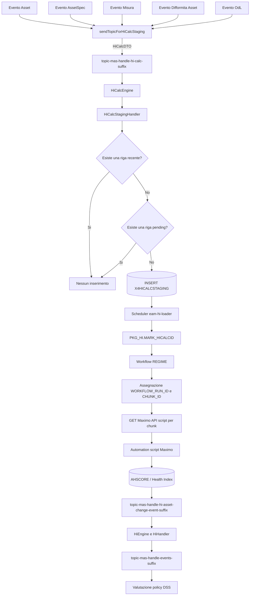

# Analisi end-to-end del flusso Health Index in `dss-manager` ed `eam-hi-loader`

## 1. Obiettivo e perimetro

Questo documento ricostruisce il flusso applicativo distribuito tra i moduli
`dss-manager` ed `eam-hi-loader`, dal primo evento Kafka fino all'esecuzione
degli script di calcolo in Maximo e alla successiva attivazione delle policy
DSS. In particolare, il processo:

1. riceve eventi relativi ad asset e oggetti collegati;
2. produce una richiesta Kafka di ricalcolo Health Index;
3. inserisce una riga nella tabella Maximo `X4HICALCSTAGING`;
4. assegna le righe a un workflow e a chunk di elaborazione;
5. invoca gli script Maximo che calcolano gli Health Index;
6. riceve successivamente gli eventi relativi agli Health Index calcolati;
7. attiva le eventuali policy DSS dipendenti dagli Health Index.

L'analisi è stata eseguita sui seguenti branch locali:

- `dss-manager`: `RITM0207744_RITM0206830_master`, commit `5c2d9fa`;
- `eam-hi-loader`: `DEV`, commit `ce38b20`.

Il secondo componente contiene il tassello che mancava nell'analisi iniziale:
lo scheduler, la chiamata esplicita a `PKG_HI.MARK_HICALCID`, la creazione del
workflow, l'assegnazione dei chunk e le chiamate HTTP agli script Maximo. Non
sono invece presenti i sorgenti PL/SQL del package `PKG_HI`, i dati di
configurazione della tabella `WORKFLOW_STEPS_HI` o il codice degli automation
script Maximo: il loro comportamento interno resta pertanto fuori dal
perimetro dimostrabile dai due repository.

## 2. Sintesi architetturale

Il processo è diviso in quattro segmenti:

1. **Acquisizione dell'evento sorgente**: `dss-manager` consuma eventi Kafka
   relativi ad asset, attributi asset, misure, difformità e ordini di lavoro.
2. **Accodamento del ricalcolo HI**: gli handler pubblicano un `HiCalcDTO` su
   un topic Kafka interno. Un listener dedicato consuma il messaggio, applica
   la deduplicazione e inserisce la richiesta in `X4HICALCSTAGING`.
3. **Orchestrazione del calcolo**: `eam-hi-loader` marca le righe, crea un
   workflow persistente, assegna workflow e chunk, quindi invoca in parallelo
   gli script Maximo configurati nella tabella `WORKFLOW_STEPS_HI`.
4. **Ritorno del risultato**: le modifiche agli HI/AHSCORE ritornano a
   `dss-manager` tramite un ulteriore topic Kafka e possono attivare policy DSS.



## 3. Eventi che richiedono il ricalcolo HI

Nel codice corrente esistono cinque chiamate a
`sendTopicForHiCalcStaging(assetNum, siteId)`.

| Evento sorgente | Endpoint di configurazione | Topic DEV | Listener | Metodo handler |
|---|---|---|---|---|
| Asset | `dssChangeAssetEventHandlerManager` | `topic-mas-handle-asset-change-event-dev` | `AssetEngine.changeAssetEventHandlerManager` | `AssetHandler.sendCreateAsset` |
| AssetSpec | `dssChangeAssetSpecForAssetEventHandlerManager` | `topic-mas-handle-assetspec-change-event-dev` | `AssetEngine.changeAssetSpecForAssetEventHandlerManager` | `AssetHandler.sendCreateAssetSpecForAsset` |
| Misura asset | `dssChangeMisureAsset` | `topic-mas-handle-misure-asset-change-event-dev` | `AssetEventEngine.handleAssetMeasureChangedEvent` | `AssetEventHandler.notifyAssetMeasureChanged` |
| Difformita associata all'asset | `dssChangeDifforForAssetEventHandlerManager` | `topic-mas-handle-diffor-asset-change-event-dev` | `DifformitaEngine.changeDifforForAssetEventHandlerManager` | `DifformitaHandler.sendCreateDifformitaForAsset` |
| Ordine di lavoro | `dssCreateOdLEventHandlerManager` | `topic-mas-handle-odl-create-event-dev` | `WorkOrderEngine.createOdLEventHandlerManager` | `WorkOrderHandler.sendCreateOdLForAsset` |

Non risultano chiamate dirette allo staging HI dagli handler di interferenze,
idoneita, eccezioni, attivita o modelli.

### 3.1 Evento Asset

`AssetEngine` consuma il topic configurato in
`dssChangeAssetEventHandlerManager`, deserializza il payload in `AssetDTO` e
chiama `AssetHandler.sendCreateAsset`.

All'inizio dell'handler viene eseguita la richiesta di ricalcolo:

```java
sendTopicForHiCalcStaging(request.getAssetnum(), request.getSiteid());
```

La chiamata precede il controllo sullo stato dell'asset. Di conseguenza anche
un evento relativo a uno stato presente in `STATUS_DECOM_ASSET` puo generare la
richiesta HI, se `assetnum` e `siteid` sono valorizzati.

Riferimenti:

- [`AssetEngine.java`](../dss-manager/src/main/java/it/terna/nas/service/engine/AssetEngine.java#L70)
- [`AssetHandler.java`](../dss-manager/src/main/java/it/terna/nas/service/exposure/handler/AssetHandler.java#L528)

### 3.2 Evento AssetSpec

`AssetEngine` consuma anche il topic AssetSpec, deserializza un `AssetSpecDTO`
e invoca `AssetHandler.sendCreateAssetSpecForAsset`.

La richiesta HI viene pubblicata prima delle verifiche applicative su
`assetattrid` e `assetspecid`. Per la pubblicazione del messaggio HI sono quindi
sufficienti `assetnum` e `siteid`.

Riferimenti:

- [`AssetEngine.java`](../dss-manager/src/main/java/it/terna/nas/service/engine/AssetEngine.java#L94)
- [`AssetHandler.java`](../dss-manager/src/main/java/it/terna/nas/service/exposure/handler/AssetHandler.java#L559)

### 3.3 Evento Misura

`AssetEventEngine` deserializza il payload in `AssetMeasureChangedEvent` e
invoca `AssetEventHandler.notifyAssetMeasureChanged`.

Prima della richiesta HI viene eseguito `checkMeasureExists`:

- `x4misureassetid` deve essere valorizzato;
- deve essere convertibile in `Long`;
- se `ultimarilevazione` e valorizzata, viene verificata l'esistenza della
  misura in `X4MISUREASSET` con una data coerente;
- una verifica fallita produce `EAMRetryException`, attivando il retry Kafka.

Dopo la verifica vengono invalidate le cache asset e viene pubblicata la
richiesta HI.

Riferimenti:

- [`AssetEventEngine.java`](../dss-manager/src/main/java/it/terna/nas/service/engine/AssetEventEngine.java#L68)
- [`AssetEventHandler.java`](../dss-manager/src/main/java/it/terna/nas/service/exposure/handler/AssetEventHandler.java#L185)

### 3.4 Evento Difformita associata all'asset

`DifformitaEngine` deserializza un `DifformitaStatDTO` e invoca
`DifformitaHandler.sendCreateDifformitaForAsset`.

La richiesta HI viene pubblicata prima della verifica
`status = VALIDATA` e prima del controllo dell'esistenza della difformita nel
database. Pertanto la richiesta di calcolo non e limitata alle sole difformita
validate.

Riferimenti:

- [`DifformitaEngine.java`](../dss-manager/src/main/java/it/terna/nas/service/engine/DifformitaEngine.java#L94)
- [`DifformitaHandler.java`](../dss-manager/src/main/java/it/terna/nas/service/exposure/handler/DifformitaHandler.java#L243)

### 3.5 Evento Ordine di lavoro

`WorkOrderEngine` deserializza un `WorkOrderDTO` e chiama
`WorkOrderHandler.sendCreateOdLForAsset`.

L'invio della richiesta HI precede il controllo
`status = APERTO` e le verifiche su `jpnum`. Ogni messaggio sul topic di
creazione/modifica OdL puo quindi richiedere il ricalcolo, purche contenga
`assetnum` e `siteid`.

Il listener dedicato alla chiusura periodica degli OdL chiama invece
`sendClosedOdLForAsset` e non presenta una chiamata diretta allo staging HI.

Riferimenti:

- [`WorkOrderEngine.java`](../dss-manager/src/main/java/it/terna/nas/service/engine/WorkOrderEngine.java#L73)
- [`WorkOrderHandler.java`](../dss-manager/src/main/java/it/terna/nas/service/exposure/handler/WorkOrderHandler.java#L191)

## 4. Pubblicazione sul topic interno HI Calc

La logica comune e implementata in `AbstractHandler`:

```java
protected void sendTopicForHiCalcStaging(String assetNum, String siteId)
```

Il metodo esegue i seguenti passaggi:

1. se `disableHiCalc` e `true`, termina immediatamente;
2. verifica che `assetNum` e `siteId` non siano vuoti;
3. costruisce un `HiCalcDTO`;
4. recupera l'endpoint `dssEventHiCalcHandler`;
5. pubblica il DTO tramite `KafkaProducerHandler.shoot`, con operazione
   `EOperation.UPDATE`.

Il payload logico prodotto e:

```json
{
  "assetNum": "1734733",
  "siteId": "SIT01"
}
```

Il DTO contiene solamente queste due proprieta:

- `assetNum`;
- `siteId`.

La configurazione dell'endpoint specifica `getAssetNum` come
`entityUuidMethodName`. La libreria Kafka del kernel usa normalmente questo
metodo per ricavare la chiave del record. Cio porta le richieste dello stesso
asset sulla stessa partizione e riduce la concorrenza sul controllo di
deduplicazione.

Riferimenti:

- [`AbstractHandler.java`](../dss-manager/src/main/java/it/terna/nas/service/exposure/handler/AbstractHandler.java#L35)
- [`HiCalcDTO.java`](../dss-manager/src/main/java/it/terna/nas/service/material/dto/hi/HiCalcDTO.java#L16)
- [`Constants.java`](../dss-manager/src/main/java/it/terna/nas/service/material/utility/Constants.java#L17)

## 5. Topic `dssEventHiCalcHandler`

Il topic interno che separa la ricezione dell'evento sorgente dalla scrittura
dello staging e configurato con la chiave logica `dssEventHiCalcHandler`.

| Ambiente/configurazione | Nome topic |
|---|---|
| File locale DEV | `topic-mas-handle-hi-calc-dev` |
| Template di deployment | `topic-mas-handle-hi-calc__kafkaTopicSuffix__` |

Nel template di deployment risultano:

- classe payload: `it.terna.nas.service.material.dto.hi.HiCalcDTO`;
- chiave: `getAssetNum`;
- concurrency: `3`;
- partizioni: `3`;
- repliche: `3`;
- numero di retry: `__topicDssHiCalcRetry__`.

Nel file locale `properties.json` concurrency e repliche valgono `1`, le
partizioni sono `3` e `entityNumberRetry` vale `2`.

Riferimenti:

- [`ConfigMap.yaml.terna`](../dss-manager/src/main/ConfigMap.yaml.terna#L458)
- [`properties.json`](../dss-manager/properties/properties.json#L446)

## 6. Consumo del topic HI Calc

`HiCalcEngine` contiene il listener:

```java
@KafkaListener(
    topics = "${broker.endPoints.dssEventHiCalcHandler.entityName}",
    groupId = "${kafka.consumer.groupId}",
    concurrency = "${broker.endPoints.dssEventHiCalcHandler.entityConcurrency}",
    containerFactory = "kafkaListenerContainerFactory"
)
```

Il consumer group locale e `eam-dss-manager`.

Il listener:

1. registra topic, offset, partizione e chiave Kafka;
2. deserializza la stringa JSON tramite Gson in `HiCalcDTO`;
3. invoca `HiCalcStagingHandler.saveHiCalcStaging(request)`;
4. rilancia le `EAMRetryException` per attivare il meccanismo di retry;
5. registra l'elaborazione completata.

Il listener e escluso se la proprieta globale `bypassBusinessLogic` e `true`.

Riferimento:

- [`HiCalcEngine.java`](../dss-manager/src/main/java/it/terna/nas/service/engine/HiCalcEngine.java#L68)

## 7. Retry e Dead Letter Topic

Il listener HI Calc e annotato con `@RetryableTopic`:

```java
@RetryableTopic(
    attempts = "${broker.endPoints.dssEventHiCalcHandler.entityNumberRetry:1}",
    include = {EAMRetryException.class},
    backoff = @Backoff(delay = 5000),
    ...
)
```

Caratteristiche:

- sono ritentate solo le `EAMRetryException`;
- il ritardo tra i tentativi e di 5 secondi;
- numero di tentativi, partizioni e repliche derivano dalla configurazione;
- al termine dei tentativi viene invocato `processDltMessage`;
- il DLT handler corrente scrive solamente un log di errore.

Spring Kafka genera topic tecnici di retry e DLT. I loro nomi fisici non sono
dichiarati esplicitamente nel progetto e dipendono dalla strategia di naming
della versione Spring Kafka e dalla configurazione runtime.

Un errore nel metodo di persistenza viene sempre convertito in
`EAMRetryException`. Un errore generico prodotto direttamente dalla
deserializzazione Gson viene invece intercettato dal secondo `catch`, registrato
e non rilanciato; un payload JSON malformato puo quindi essere considerato
consumato senza passare dal retry applicativo.

## 8. Persistenza in `X4HICALCSTAGING`

La persistenza e gestita da:

```java
@Transactional
@Datasource(datasourceKey = EDatasourceKey.EAM)
public void saveHiCalcStaging(HiCalcDTO request)
```

Il database configurato e Oracle, con dialetto Hibernate
`Oracle12cDialect`.

Riferimenti:

- [`HiCalcStagingHandler.java`](../dss-manager/src/main/java/it/terna/nas/service/exposure/handler/HiCalcStagingHandler.java#L32)
- [`DatabaseConfiguration.java`](../dss-manager/src/main/java/it/terna/nas/service/configuration/DatabaseConfiguration.java#L14)

### 8.1 Primo controllo: elaborazione recente

La prima query e:

```sql
SELECT count(X4HICALCSTAGINGID)
FROM X4HICALCSTAGING
WHERE ASSETNUM = :assetnum
  AND SITEID = :siteId
  AND NVL(LASTUPDATE, CREATEDATE) >=
      (SYSDATE - :minutes/1440)
  AND ROWNUM = 1
```

Se il risultato e maggiore di zero, il metodo termina senza eseguire ulteriori
operazioni.

La finestra temporale e determinata da `hiCheckAssetInMin`. L'annotazione usa
un default di 10 minuti:

```java
@Value("${hiCheckAssetInMin:10}")
```

Nei file di configurazione esaminati non e presente un valore esplicito per
questa proprieta; in assenza di un'iniezione esterna viene quindi usato il
default di 10 minuti.

Il controllo considera:

- `LASTUPDATE`, se valorizzata;
- altrimenti `CREATEDATE`.

`LASTUPDATE` non e mappata nell'entity Java. E pertanto una colonna gestita da
Maximo, dal database o da un altro processo esterno a questo codice.

### 8.2 Secondo controllo: richiesta pending

Se non esistono elaborazioni recenti, viene eseguita la query JPQL:

```sql
select count(c)
from X4HiCalcStaging c
where c.siteId = :siteId
  and c.assetnum = :assetnum
  and c.hiCalcId is null
```

La condizione non contiene limiti temporali. Una qualsiasi riga con
`HICALCID IS NULL` impedisce l'inserimento di una nuova richiesta per la stessa
coppia asset/sito, anche se la riga e molto vecchia.

Riferimento:

- [`X4HiCalcStagingRepository.java`](../dss-manager/src/main/java/it/terna/nas/service/dal/service/repository/X4HiCalcStagingRepository.java#L10)

### 8.3 Inserimento

Se entrambi i controlli sono negativi, viene costruita un'entita
`X4HiCalcStaging` con:

| Colonna | Valore all'inserimento |
|---|---|
| `X4HICALCSTAGINGID` | Generato dalla sequence `X4HICALCSTAGINGIDSEQ` |
| `SITEID` | `request.siteId` |
| `ASSETNUM` | `request.assetNum` |
| `HICALCID` | `NULL` |
| `CREATEDATE` | Data e ora applicativa corrente |

Dopo `repository.save(row)` viene chiamato
`EamEtlUtils.detach(entityManager, true, saved)`. Il parametro `true` provoca
un `entityManager.flush()` prima del detach. L'operazione rimane comunque
all'interno della transazione e viene resa definitiva al commit.

Riferimenti:

- [`X4HiCalcStaging.java`](../dss-manager/src/main/java/it/terna/nas/service/dal/entity/eam/X4HiCalcStaging.java#L17)
- [`HiCalcStagingHandler.java`](../dss-manager/src/main/java/it/terna/nas/service/exposure/handler/HiCalcStagingHandler.java#L45)
- [`EamEtlUtils.java`](../dss-manager/src/main/java/it/terna/nas/service/material/utility/EamEtlUtils.java#L18)

## 9. Significato dello stato della riga

Dal comportamento del codice si puo ricavare il seguente modello:

| Stato | Interpretazione |
|---|---|
| Riga assente | Nessuna richiesta HI accodata per asset/sito |
| Riga presente e `HICALCID IS NULL` | Richiesta pending o non completata; nuove richieste vengono bloccate |
| Riga con `HICALCID` valorizzato e aggiornamento recente | Elaborazione gia avvenuta recentemente; nuove richieste vengono temporaneamente ignorate |
| Riga con `HICALCID` valorizzato e aggiornamento oltre la finestra | Puo essere inserita una nuova richiesta |

`dss-manager` non valorizza mai `HICALCID` e non aggiorna `LASTUPDATE`.
`eam-hi-loader` prende in carico queste righe iniziando ogni ciclo con la
procedura `PKG_HI.MARK_HICALCID`; l'implementazione PL/SQL che stabilisce
esattamente come vengono valorizzate le colonne non è inclusa nei repository.

## 10. Presa in carico ed elaborazione in `eam-hi-loader`

### 10.1 Attivazione dello scheduler

`eam-hi-loader` abilita Spring Scheduling e ShedLock. Il task principale è
`ScheduledHiLoaderTask.runScheduledHiLoaderTask`:

```java
@Scheduled(cron = "${scheduler.hiLoader.cron}")
@SchedulerLock(
    name = "${scheduler.hiLoader.name}",
    lockAtLeastFor = "${scheduler.hiLoader.lockAtLeastFor}",
    lockAtMostFor = "${scheduler.hiLoader.lockAtMostFor}"
)
```

La configurazione locale esegue il controllo ogni tre minuti:

```text
0 */3 * * * *
```

In deployment il cron è fornito dal placeholder `__hiLoaderCron__`. Il task può
essere disabilitato con `scheduler.hiLoader.disable`; il valore locale e quello
del template sono `false`.

La protezione da esecuzioni concorrenti è composta da:

- un `AtomicBoolean` locale al processo Java;
- un lock distribuito ShedLock memorizzato su MongoDB;
- la verifica applicativa che l'ultimo record di `WORKFLOW_LAUNCHES_HI` abbia
  stato `COMPLETED`.

Se l'ultimo workflow non è terminato, il nuovo ciclo viene ignorato.

Riferimenti:

- [`EamHILoaderApplication.java`](../eam-hi-loader/src/main/java/it/terna/nas/service/EamHILoaderApplication.java#L18)
- [`ScheduledHiLoaderTask.java`](../eam-hi-loader/src/main/java/it/terna/nas/service/scheduler/ScheduledHiLoaderTask.java#L17)
- [`ShedlockConfig.java`](../eam-hi-loader/src/main/java/it/terna/nas/service/configuration/ShedlockConfig.java#L10)
- [`properties.json`](../eam-hi-loader/properties/properties.json#L130)

### 10.2 Chiamata a `PKG_HI.MARK_HICALCID`

Quando può partire un nuovo ciclo, `HiLoaderTaskHandler` esegue per prima cosa:

```java
x4HICalcStagingTableService.callProcedure("PKG_HI.MARK_HICALCID");
```

La procedura viene chiamata sul datasource Oracle `EAM`, senza parametri,
tramite `DataAccessService.executeStoredProcedure`.

Questa è la chiamata esplicita che collega le righe prodotte da `dss-manager`
al processo HI. Dal nome e dall'ordine delle operazioni si deduce che la
procedura assegni o consolidi `HICALCID` sulle righe ancora pending, ma questa
semantica è un'inferenza: il body PL/SQL di `PKG_HI.MARK_HICALCID` non è
presente nel repository.

Se la procedura fallisce, `X4HICalcStagingTableService` trasforma l'errore in
`EAMException`, `HiLoaderTaskHandler` lo converte in `RuntimeException` e il
task scheduler registra l'errore. In quel ciclo non viene creato alcun workflow.

Riferimenti:

- [`HiLoaderTaskHandler.java`](../eam-hi-loader/src/main/java/it/terna/nas/service/exposure/handler/HiLoaderTaskHandler.java#L25)
- [`X4HICalcStagingTableService.java`](../eam-hi-loader/src/main/java/it/terna/nas/service/dal/service/steps/X4HICalcStagingTableService.java#L303)

### 10.3 Creazione del workflow `REGIME`

Dopo la procedura, il task:

1. imposta `SchedulerState` in modalità `REGIME`;
2. crea una `LaunchRequest` vuota;
3. chiama `EamHIHandler.addWorkflowLaunch`;
4. inserisce una riga in `WORKFLOW_LAUNCHES_HI`.

La nuova riga contiene:

| Colonna | Valore iniziale |
|---|---|
| `ID` | Sequence `SEQ_WORKFLOW_LAUNCHES_HI` |
| `START_DATE` | Data corrente |
| `END_DATE` | `NULL` |
| `STATUS` | `RUNNING` |
| `FIRST_ELAB_SCHEDULE` | `true` |
| `WORKFLOW_NAME` | `REGIME` |

`WorflowLaunchHIService.createLaunch` impedisce inoltre la creazione se trova
già un workflow `RUNNING`.

Esiste anche una modalità manuale `TRANSITORIO`, attivabile tramite
`GET /eam/hi/launcher/main`. L'endpoint
`GET /eam/hi/launcher/regime` crea invece manualmente un workflow `REGIME`.
La differenza principale è che in modalità `REGIME` il caricamento degli step
esclude lo step con `ID = 1`; in modalità `TRANSITORIO` vengono caricati tutti
gli step abilitati.

Entrambi gli endpoint manuali chiamano direttamente `addWorkflowLaunch` e non
eseguono preventivamente `PKG_HI.MARK_HICALCID`. Inoltre il task schedulato non
verifica che esistano righe da elaborare: può creare una launch `REGIME` anche
quando lo staging è vuoto; in tal caso gli step `NEW` non trovano record e
terminano senza chiamate per chunk.

Riferimenti:

- [`WorflowLaunchHIService.java`](../eam-hi-loader/src/main/java/it/terna/nas/service/dal/service/WorflowLaunchHIService.java#L32)
- [`WorkflowLaunchHI.java`](../eam-hi-loader/src/main/java/it/terna/nas/service/dal/entity/eam/WorkflowLaunchHI.java#L16)
- [`EamHIController.java`](../eam-hi-loader/src/main/java/it/terna/nas/service/exposure/controller/EamHIController.java#L39)

### 10.4 Motore del workflow

Un secondo scheduler, indipendente da quello che crea il workflow, esegue
`WorkflowHIEngine.executeSteps` a intervallo fisso:

```java
@Scheduled(fixedDelayString = "${workflowScheduleRate:30000}",
           initialDelay = 1000)
```

Il valore locale e quello di deployment sono `1000` millisecondi. Il motore
controlla quindi circa ogni secondo la presenza di una launch `RUNNING`.

Gli step non sono hard-coded: vengono letti dalla tabella
`WORKFLOW_STEPS_HI`, considerando solo quelli con `ENABLED = true` e ordinandoli
per `STEP_ORDER`. Ogni record definisce:

- ordine e descrizione;
- nome dello script Maximo;
- parametri 1 e 2;
- dimensione del chunk;
- livello di parallelismo;
- classe Java che esegue lo step;
- nome di una stored procedure o funzione;
- `LEVEL_TYPE`;
- flag `STEP_BLOCKING`.

Il codice non contiene i dati della tabella `WORKFLOW_STEPS_HI`; non è quindi
possibile elencare con certezza nomi, ordine, parametri e procedure effettivi
dei singoli step di un ambiente. Il flag `STEP_BLOCKING` viene caricato e
registrato nei log, ma non è usato nella logica decisionale del motore: gli
step risultano comunque eseguiti sequenzialmente.

Riferimenti:

- [`WorkflowHIEngine.java`](../eam-hi-loader/src/main/java/it/terna/nas/service/engine/WorkflowHIEngine.java#L88)
- [`WorkflowStepHIService.java`](../eam-hi-loader/src/main/java/it/terna/nas/service/dal/service/WorkflowStepHIService.java#L31)
- [`WorkflowStepHI.java`](../eam-hi-loader/src/main/java/it/terna/nas/service/dal/entity/eam/WorkflowStepHI.java#L10)

### 10.5 Tipologie di step

`BaseStepRunnerHI` distingue tre valori di `LEVEL_TYPE`.

#### `NEW`

È la tipologia che lavora direttamente su `X4HICALCSTAGING` tramite
`StepX4HICalcStaging`:

1. conta le righe con `CHUNK_ID IS NULL` e `WORKFLOW_RUN_ID IS NULL`;
2. se ne esistono, chiama la stored procedure configurata nello step;
3. passa alla procedura `V_WORKFLOW_RUN_ID = launchId` e
   `V_CHUNK_SIZE = stepChunkSize`;
4. se `loadedHI` è valorizzato e maggiore di zero, passa anche `V_LOADED`;
5. recupera i `CHUNK_ID` distinti assegnati a quel workflow e con
   `RESULT IS NULL`;
6. invoca lo script Maximo configurato una volta per ogni chunk.

Il nome della procedura di chunking viene dalla colonna
`STORE_PROCEDURE_NAME` di `WORKFLOW_STEPS_HI`; non è presente nel codice.

#### `POPULATION`

È gestita da `StepBasePopulateX4HICalcStaging`. Invoca la stored procedure
configurata nello step, con l'eventuale parametro `V_LOADED`, e conclude senza
effettuare chiamate HTTP a Maximo. È presumibilmente uno step propedeutico, ma
la sua funzione esatta dipende dalla procedura configurata nel database.

#### `LAUNCHER`

Usa un chunk sintetico con valore `1` ed effettua una singola chiamata allo
script Maximo. `StepLaunchScript.verifyIfIHaveCompleted` interroga inoltre la
funzione configurata nello step con:

```sql
SELECT <STORE_PROCEDURE_NAME>('<PARAMETER1>') AS TOTALCOUNT
FROM dual
```

Lo step è considerato completato quando la funzione restituisce `0`.

Riferimenti:

- [`BaseStepRunnerHI.java`](../eam-hi-loader/src/main/java/it/terna/nas/service/engine/BaseStepRunnerHI.java#L128)
- [`StepX4HICalcStaging.java`](../eam-hi-loader/src/main/java/it/terna/nas/service/engine/steps/StepX4HICalcStaging.java#L10)
- [`PopulatePropedeuticStagingAreaTablesX4HICalc.java`](../eam-hi-loader/src/main/java/it/terna/nas/service/dal/service/steps/propedeutic/PopulatePropedeuticStagingAreaTablesX4HICalc.java#L20)
- [`StepLaunchScript.java`](../eam-hi-loader/src/main/java/it/terna/nas/service/engine/steps/StepLaunchScript.java#L14)

### 10.6 Arricchimento di `X4HICALCSTAGING`

L'entity di `eam-hi-loader` espone molte più colonne rispetto all'entity di
`dss-manager`:

| Colonna | Uso nel loader |
|---|---|
| `X4HICALCSTAGINGID` | Identificativo della richiesta |
| `SITEID`, `ASSETNUM` | Asset da elaborare |
| `HICALCID` | Identificativo HI assegnato dal processo DB/Maximo |
| `WORKFLOW_RUN_ID` | Workflow che ha preso in carico la riga |
| `CHUNK_ID` | Gruppo passato allo script Maximo |
| `RESULT` | `OK`, `KO` o `NULL` durante l'elaborazione |
| `RESULT_DESCRIPTION` | Descrizione dell'errore |
| `STEP_TIMEOUT_FLAG` | Indicatore di timeout/errore di connessione |
| `CHUNK_ID_RECUPERO` | Chunk già sottoposto a recupero |
| `CREATEDATE`, `LASTUPDATE` | Timestamp di creazione/aggiornamento |
| `ELAPSED`, `ELAPSEDALN` | Tempi di elaborazione |

Il primo arricchimento osservabile dal Java avviene tramite la procedura di
chunking dello step `NEW`, che riceve il workflow ID e la dimensione chunk.
L'aggiornamento di `RESULT`, dei tempi e degli eventuali dati HI è invece a
carico delle stored procedure e degli script Maximo.

Riferimento:

- [`X4HICalcStaging.java`](../eam-hi-loader/src/main/java/it/terna/nas/service/dal/entity/eam/X4HICalcStaging.java#L12)

### 10.7 Invocazione degli script Maximo

Per ogni chunk `MaximoApiHandler.invokeScriptHI` esegue una richiesta HTTP:

```text
GET https://<host-maximo>/maximo/api/script/{maximoScript}
```

`{maximoScript}` viene sostituito con `SCRIPT_NAME` dello step. I query
parameter inviati sono:

| Parametro HTTP | Provenienza |
|---|---|
| `ASSETTYPE` | `StepDto.parameter1`, salvo valore `NA` |
| `parameter2` | `StepDto.parameter2`, salvo valore `NA` |
| `CHUNKID` | Chunk corrente |
| `chunkid` | Lo stesso chunk, inviato anche in minuscolo |
| `LOADED` | Proprietà `loadedHI`, se non nulla |

L'header `apikey` viene scelto da una lista di chiavi configurate, usando
`chunkId % numeroChiavi`. Questo distribuisce i chunk sulle credenziali
disponibili. Le chiamate vengono eseguite in `CompletableFuture` e raggruppate
secondo `STEP_PARALLEL_LEVEL`.

Una risposta è considerata valida quando:

- il codice HTTP è `200`;
- il body non contiene una delle stringhe definite da `maximoError`.

Nella configurazione esaminata `maximoError = BMX`, quindi anche una risposta
HTTP 200 contenente un errore Maximo `BMX...` viene trasformata in errore
applicativo.

Riferimenti:

- [`MaximoApiHandler.java`](../eam-hi-loader/src/main/java/it/terna/nas/service/exposure/handler/MaximoApiHandler.java#L77)
- [`ConfigMap.yaml.terna`](../eam-hi-loader/src/main/ConfigMap.yaml.terna#L123)

### 10.8 Tracking del workflow e degli step

Ogni step avviato genera una riga in `WORKFLOW_RUNNING_STEPS_HI` con:

- `WORKFLOW_LAUNCH_ID`;
- `WORKFLOW_STEPS_ID`;
- `START_DATE`;
- stato iniziale `RUNNING`.

Al termine della chiamata Java lo stato diventa:

- `COMPLETED` se tutte le risposte HTTP sono considerate valide;
- `ERROR` se almeno una risposta è in errore o l'esecuzione fallisce.

Prima di procedere allo step successivo, il motore verifica lo stato delle
righe di staging del workflow. Per lo step su `X4HICALCSTAGING` considera non
terminate le righe con:

```sql
CHUNK_ID IS NOT NULL
AND (RESULT <> 'OK' OR RESULT IS NULL)
AND WORKFLOW_RUN_ID = :launchId
```

Il completamento funzionale dipende quindi dal fatto che lo script Maximo
aggiorni `RESULT = 'OK'`; la sola risposta HTTP 200 non basta per superare la
verifica del passo precedente.

Riferimenti:

- [`WorkflowRunningStepHIService.java`](../eam-hi-loader/src/main/java/it/terna/nas/service/dal/service/WorkflowRunningStepHIService.java#L60)
- [`X4HICalcStagingTableService.java`](../eam-hi-loader/src/main/java/it/terna/nas/service/dal/service/steps/X4HICalcStagingTableService.java#L137)

### 10.9 Errori, timeout e recupero dei chunk

Quando una chiamata REST restituisce errore, `BaseStepRunnerHI` cerca le righe
del chunk con `RESULT IS NULL` e imposta:

- `RESULT = 'KO'`;
- `RESULT_DESCRIPTION` con i primi 100 caratteri dell'errore;
- teoricamente `STEP_TIMEOUT_FLAG = 'Y'` per errori di connessione o timeout.

Prima dello step successivo vengono distinti:

- errori recuperabili, identificati dal timeout flag o da descrizioni presenti
  in `maximoErrorToRework`;
- altri errori, registrati nei log come blacklist e non rielaborati.

Per gli errori recuperabili il motore dovrebbe impostare
`CHUNK_ID_RECUPERO = CHUNK_ID` e richiamare lo script per i chunk interessati.
Nell'implementazione corrente i setter di `STEP_TIMEOUT_FLAG` e
`CHUNK_ID_RECUPERO` dell'entity sono però vuoti; il recupero effettivo presenta
quindi il difetto descritto nella sezione 16.8.

La configurazione di deployment considera recuperabili:

- `BMXAA4195E`;
- `BMXAA8229W`;
- `BMXAA4214E`;
- `JYTHON ERROR`;
- `BMXAA0024E`.

### 10.10 Completamento della launch

Quando tutti gli step abilitati hanno una corrispondente riga di esecuzione e
nessuno è ancora `RUNNING`, `WorkflowHIEngine`:

1. valorizza `END_DATE`;
2. imposta `WORKFLOW_LAUNCHES_HI.STATUS = COMPLETED`;
3. se il workflow era `TRANSITORIO`, riporta lo stato in `REGIME`;
4. se era `REGIME` e `aggregatePolicyFlag = true`, pubblica gli eventi per le
   policy aggregate.

Il controllo di completamento verifica l'assenza di step `RUNNING`, ma non
richiede che tutti gli step siano `COMPLETED`: anche uno step `ERROR` è
considerato non più in esecuzione. Questa caratteristica è rilevante per il
monitoraggio degli esiti.

### 10.11 Pubblicazione delle policy aggregate

Se `aggregatePolicyFlag` è attivo, al termine del workflow `REGIME` vengono
selezionate le policy con:

```text
policyAggr = 1 AND status = 'ATTIVA'
```

Per ciascuna viene prodotto un `EventDTO` di tipo `POLICY`, evento `ADD`, sul
topic Kafka già consumato dal `PolicyEngine` di `dss-manager`:

- DEV: `topic-mas-handle-events-dev`;
- deployment: `topic-mas-handle-events__kafkaTopicSuffix__`.

L'esecuzione viene registrata in `X4_DSS_AGG_POLICY_CRON` con stato
`ELABORATED`.

Nella configurazione locale `aggregatePolicyFlag` è `false`; in deployment il
valore è fornito da `__eamAggregatePolicyFlag__`.

La classe contiene anche `sendAggregatePolicyMessage`, che controlla in
`CRONTASKHISTORY` l'assenza di un cron Maximo `AHSCORINGGROUP` attivo e applica
un intervallo minimo fra due invii. Il workflow corrente non chiama però quel
metodo: chiama `sendAggregatePolicyKafkaMessage`, che invia immediatamente le
policy aggregate senza il controllo su `AHSCORINGGROUP` e senza throttling
temporale.

Riferimento:

- [`TaskPolicyAggregateHandler.java`](../eam-hi-loader/src/main/java/it/terna/nas/service/exposure/handler/TaskPolicyAggregateHandler.java#L140)

### 10.12 Ruolo di Kafka in `eam-hi-loader`

`eam-hi-loader` non consuma il topic `topic-mas-handle-hi-calc-{suffix}` e non
riceve un evento Kafka per ogni riga di staging. Il raccordo con `dss-manager`
è esclusivamente la tabella Oracle `X4HICALCSTAGING`.

Kafka entra nuovamente in gioco soltanto, e opzionalmente, alla fine del
workflow per notificare le policy aggregate su
`topic-mas-handle-events-{suffix}`. Il calcolo HI viene invece avviato da uno
scheduler e prosegue con stored procedure Oracle e chiamate REST a Maximo.

### 10.13 Sequenza completa del loader

La sequenza osservabile nel codice è:

1. lo scheduler scatta secondo `scheduler.hiLoader.cron`;
2. verifica che sia abilitato, che il task locale non stia già girando e che
   l'ultimo workflow sia `COMPLETED`;
3. acquisisce il lock ShedLock distribuito;
4. invoca `PKG_HI.MARK_HICALCID`;
5. crea una launch `REGIME` in `WORKFLOW_LAUNCHES_HI`;
6. il motore workflow rileva la launch entro circa un secondo;
7. carica gli step abilitati da `WORKFLOW_STEPS_HI`, escludendo l'ID 1;
8. registra ogni esecuzione in `WORKFLOW_RUNNING_STEPS_HI`;
9. per uno step `NEW`, assegna `WORKFLOW_RUN_ID` e `CHUNK_ID` tramite la
   procedura configurata;
10. invoca in parallelo lo script Maximo configurato per ogni chunk;
11. gli script aggiornano risultati di staging e dati HI/AHSCORE;
12. il motore gestisce eventuali errori recuperabili e passa agli step
    successivi;
13. marca la launch `COMPLETED`;
14. opzionalmente pubblica le policy aggregate su Kafka;
15. gli eventi di modifica AHSCORE rientrano separatamente nel flusso
    `dss-manager` descritto nella sezione successiva.

## 11. Flusso di ritorno degli HI calcolati

Il repository contiene un flusso separato che gestisce le modifiche agli
Health Index in Maximo. Questo costituisce il probabile ramo di ritorno dopo
l'elaborazione dello staging, anche se non esiste nel codice una correlazione
diretta con `X4HICALCSTAGINGID` o `HICALCID`.

### 11.1 Topic HI dell'asset

| Ambiente/configurazione | Nome topic |
|---|---|
| DEV | `topic-mas-handle-hi-asset-change-event-dev` |
| Deployment | `topic-mas-handle-hi-asset-change-event__kafkaTopicSuffix__` |

`HiEngine` consuma il topic e deserializza un `HiDTO` contenente:

- `ahscoreid`;
- `objectname`;
- `value`;
- `previousvalue`;
- `attributename`;
- `ownerrecordid`;
- `_action`.

Riferimenti:

- [`HiEngine.java`](../dss-manager/src/main/java/it/terna/nas/service/engine/HiEngine.java#L68)
- [`HiDTO.java`](../dss-manager/src/main/java/it/terna/nas/service/material/dto/hi/HiDTO.java#L16)

### 11.2 Validazione dell'evento HI

`HiHandler.sendCreateHi` prosegue soltanto se:

- `value` e presente;
- `value` e diverso da `previousvalue`;
- `ownerrecordid` e presente;
- `attributename` e presente.

Viene inoltre eseguita `validateAhscoreValue`, che verifica:

1. presenza di `ahscoreid`;
2. validita numerica di `value`;
3. esistenza della riga `AHSCORE`;
4. uguaglianza numerica fra il valore ricevuto e il valore gia presente nel
   database.

Se la riga AHSCORE non e ancora visibile o il valore non coincide, viene
generata `EAMRetryException`. Questo protegge il sistema da eventi Kafka che
arrivano prima del commit Maximo.

### 11.3 Produzione dell'evento DSS di tipo HI

Dopo la validazione:

1. viene recuperato l'asset tramite `ownerrecordid`;
2. vengono invalidate le cache standard e slim dell'asset;
3. viene creato un `EventDTO` con `type = HI` ed `event = MODIFY`;
4. la chiave assume il formato `HI-<ahscoreid>-<timestamp>`;
5. `attributename` viene inserito nella mappa degli attributi;
6. il messaggio viene pubblicato su `dssEventHandlerManager`.

Topic:

- DEV: `topic-mas-handle-events-dev`;
- deployment: `topic-mas-handle-events__kafkaTopicSuffix__`.

Riferimento:

- [`HiHandler.java`](../dss-manager/src/main/java/it/terna/nas/service/exposure/handler/HiHandler.java#L178)

### 11.4 Valutazione delle policy dipendenti dall'HI

`PolicyEngine.eventManager` consuma `topic-mas-handle-events-{suffix}` e, per
`type = HI`, chiama `HiHandler.handleEvent`.

Il processo:

1. legge l'attributo HI dall'evento;
2. recupera l'asset e la sua classificazione;
3. individua le policy associate alla classificazione e a quell'HI;
4. determina il tipo di evento da inviare al worker;
5. crea `X4DSSPOLICYRUNNER`;
6. crea `X4DSSWORKEDHISTORY`;
7. costruisce un `WorkedPolicyRequestEvent` per ogni policy;
8. pubblica gli eventi sul topic dei worker DSS.

Topic worker:

- DEV: `topic-mas-dss-workers-dev`;
- deployment: `topic-mas-dss-workers__kafkaTopicSuffix__`.

Riferimenti:

- [`PolicyEngine.java`](../dss-manager/src/main/java/it/terna/nas/service/engine/PolicyEngine.java#L192)
- [`HiHandler.java`](../dss-manager/src/main/java/it/terna/nas/service/exposure/handler/HiHandler.java#L63)

Questo ramo non calcola l'Health Index: reagisce a un valore HI gia calcolato e
salvato in Maximo.

## 12. Inventario completo dei topic del flusso

### 12.1 Topic che possono causare lo staging

| Ruolo | Nome template |
|---|---|
| Evento Asset | `topic-mas-handle-asset-change-event__kafkaTopicSuffix__` |
| Evento AssetSpec | `topic-mas-handle-assetspec-change-event__kafkaTopicSuffix__` |
| Evento misura | `topic-mas-handle-misure-asset-change-event__kafkaTopicSuffix__` |
| Evento difformita/asset | `topic-mas-handle-diffor-asset-change-event__kafkaTopicSuffix__` |
| Evento OdL | `topic-mas-handle-odl-create-event__kafkaTopicSuffix__` |
| Richiesta interna di staging HI | `topic-mas-handle-hi-calc__kafkaTopicSuffix__` |

### 12.2 Topic successivi al calcolo Maximo

| Ruolo | Nome template |
|---|---|
| Modifica HI/AHSCORE dell'asset | `topic-mas-handle-hi-asset-change-event__kafkaTopicSuffix__` |
| Event bus interno DSS | `topic-mas-handle-events__kafkaTopicSuffix__` |
| Valutazione policy da parte dei worker | `topic-mas-dss-workers__kafkaTopicSuffix__` |

### 12.3 Topic tecnici

Per ciascun listener annotato con `@RetryableTopic`, Spring Kafka puo creare:

- uno o piu topic di retry;
- un Dead Letter Topic.

Il progetto non ne definisce esplicitamente i nomi. Non devono quindi essere
confusi con i nove topic funzionali elencati sopra.

## 13. Configurazioni che governano il flusso

### `disableHiCalc`

Controlla esclusivamente la produzione del messaggio interno
`dssEventHiCalcHandler`.

- default nell'annotazione: `false`;
- valore nel `properties.json` locale: `true`;
- valore nel template di deployment: `__disableHiCalc__`.

Se e `true`, nessuno dei cinque handler produce richieste HI e quindi non si
arriva alla tabella di staging attraverso questo flusso.

### `bypassBusinessLogic`

Viene controllata nei listener Kafka, incluso `HiCalcEngine`. Se vale `true`,
il messaggio viene ricevuto ma la logica applicativa non viene eseguita.

### `hiCheckAssetInMin`

Definisce la finestra di blocco dopo una riga recentemente creata o aggiornata.
Il default applicativo e 10 minuti.

### Consumer group

Nel file locale il consumer group e `eam-dss-manager`. Nel deployment deriva
dalla configurazione esterna.

### Configurazione producer locale

Il producer locale e configurato con:

- `acks = all`;
- idempotenza abilitata;
- 12 retry di trasporto;
- compressione Snappy;
- massimo 5 richieste in-flight per connessione.

Questi retry di trasporto Kafka sono distinti dai retry applicativi dei
listener gestiti da `@RetryableTopic`.

Riferimenti:

- [`properties.json`](../dss-manager/properties/properties.json#L39)
- [`ConfigMap.yaml.terna`](../dss-manager/src/main/ConfigMap.yaml.terna#L508)

### Configurazioni principali di `eam-hi-loader`

| Proprietà | Valore locale | Effetto |
|---|---:|---|
| `scheduler.hiLoader.cron` | `0 */3 * * * *` | Controllo dello staging ogni tre minuti |
| `scheduler.hiLoader.disable` | `false` | Abilita/disabilita il task |
| `scheduler.hiLoader.lockAtLeastFor` | `PT1M` | Durata minima del lock distribuito |
| `scheduler.hiLoader.lockAtMostFor` | `PT3M` | Scadenza massima del lock distribuito |
| `workflowScheduleRate` | `1000` ms | Frequenza del motore workflow |
| `executorThreadPool` | `100` | Pool usato per le chiamate parallele |
| `maximoError` | `BMX` | Pattern che trasforma una risposta HTTP 200 in errore |
| `maximoErrorToRework` | elenco di codici | Errori candidabili al recupero |
| `loadedHI` | `null` | Filtro/parametro opzionale passato a procedure e script |
| `dummyExecutionHI` | stringa vuota | Suffisso opzionale per selezionare implementazioni alternative degli step |
| `aggregatePolicyFlag` | `false` | Abilita l'invio delle policy aggregate a fine workflow |

In deployment cron, lock e flag policy sono sostituiti tramite placeholder. La
configurazione effettiva dell'ambiente prevale quindi sui valori locali.

Riferimenti:

- [`properties.json`](../eam-hi-loader/properties/properties.json#L129)
- [`ConfigMap.yaml.terna`](../eam-hi-loader/src/main/ConfigMap.yaml.terna#L141)

## 14. Idempotenza e concorrenza

La gestione dei duplicati si basa su tre livelli:

1. producer Kafka con idempotenza abilitata;
2. chiave del topic HI Calc basata su `assetNum`, che ordina gli eventi dello
   stesso asset nella stessa partizione;
3. doppio controllo applicativo su righe recenti e righe pending.

Esistono comunque alcuni limiti:

- le due query e l'insert implementano un `check-then-insert`;
- nel codice non e visibile un lock pessimista;
- non e visibile un constraint univoco su `SITEID`, `ASSETNUM` e stato pending;
- consumer group differenti o inserimenti esterni potrebbero superare la
  serializzazione garantita dalla partizione Kafka;
- la chiave dichiarata e il solo `assetNum`, non la coppia asset/sito.

La garanzia effettiva contro duplicati concorrenti dipende quindi anche dagli
indici e constraint Oracle, non inclusi nel repository.

Nel loader la concorrenza è ulteriormente limitata da ShedLock e dal vincolo
applicativo di una sola launch `RUNNING`. Non è però visibile nel codice un
constraint DB univoco sullo stato `RUNNING`; due richieste manuali perfettamente
concorrenti possono entrambe superare il controllo `isRunning()` se il database
non applica un vincolo aggiuntivo.

## 15. Confini transazionali

La ricezione dell'evento sorgente, la pubblicazione del messaggio HI Calc e
l'inserimento Oracle non fanno parte di un'unica transazione distribuita.

In particolare:

- l'handler dell'evento sorgente pubblica un nuovo messaggio Kafka;
- altre operazioni dello stesso handler possono fallire successivamente;
- il messaggio sorgente puo essere ritentato;
- il retry puo produrre un nuovo `HiCalcDTO`;
- la deduplicazione sulla tabella e quindi necessaria per assorbire queste
  ripetizioni.

Non e presente un pattern outbox applicativo per questa specifica catena.

Anche nel loader le operazioni principali non costituiscono una singola
transazione atomica:

- `PKG_HI.MARK_HICALCID` viene completata prima della creazione della launch;
- la creazione della launch e l'avvio degli step sono separati;
- la procedura di chunking precede le chiamate HTTP a Maximo;
- gli aggiornamenti eseguiti dagli script Maximo sono esterni alla transazione
  Java;
- la chiusura del workflow e l'eventuale pubblicazione Kafka delle policy
  aggregate sono operazioni distinte.

Un'interruzione può quindi lasciare righe marcate ma non ancora assegnate a un
workflow, chunk assegnati ma non elaborati, oppure uno step `RUNNING` da
recuperare al successivo riavvio.

## 16. Criticita e rischi operativi

### 16.1 Riga pending bloccante senza scadenza

Una riga con `HICALCID IS NULL` blocca nuove richieste per lo stesso asset/sito
finché un'esecuzione riuscita di `PKG_HI.MARK_HICALCID` non la prende in carico
o finché la riga non viene eliminata/corretta. La query pending di
`dss-manager` non considera `CREATEDATE` o `LASTUPDATE`.

Questo e il rischio principale in caso di blocco della procedura Maximo.

### 16.2 DLT gestito solamente tramite log

Il DLT handler non aggiorna una tabella errori, non invia notifiche e non
reintroduce il messaggio. Il recupero dipende quindi dal monitoraggio dei log o
da strumenti Kafka esterni.

### 16.3 Errori di deserializzazione non ritentati

Le eccezioni generiche in `HiCalcEngine`, incluse potenzialmente quelle Gson,
vengono loggate senza essere rilanciate. Un messaggio malformato puo quindi
essere perso dal punto di vista funzionale.

### 16.4 Finestra temporale non esplicitata nel deployment

`hiCheckAssetInMin` non compare nel `ConfigMap.yaml.terna`. Salvo proprietà
esterne aggiuntive, viene usato implicitamente il default di 10 minuti.

### 16.5 Configurazione locale disabilitata

Il file locale imposta `disableHiCalc = true`. Un test eseguito con tale file
non puo produrre righe di staging tramite questo flusso.

### 16.6 Assenza di correlazione end-to-end

Il `HiCalcDTO` contiene solo asset e sito. Non contiene:

- identificativo dell'evento sorgente;
- topic e offset originali;
- correlation ID;
- `X4HICALCSTAGINGID`;
- identificativo della futura elaborazione Maximo.

Il ramo di ritorno usa `ahscoreid` e `ownerrecordid`, senza riferimenti alla
riga di staging. La correlazione end-to-end deve essere ricostruita tramite
asset, tempi e dati Maximo.

### 16.7 Metadati dei topic sorgente

Diversi endpoint sorgente dichiarano in configurazione
`ProcessStatusResponse` come `entityObjectClass`, mentre i listener
deserializzano DTO specifici (`AssetDTO`, `AssetSpecDTO`,
`AssetMeasureChangedEvent`, `DifformitaStatDTO`). Questo campo potrebbe essere
usato soltanto dalla libreria di produzione o come metadato, ma la discrepanza
merita una verifica nella libreria kernel.

### 16.8 Setter di recupero non operativi su `X4HICalcStaging`

L'entity `eam-hi-loader` dichiara esplicitamente:

```java
@Override
public void setChunkIdRecupero(Integer a) {
}

@Override
public void setStepTimeoutFlag(Character flag) {
}
```

Questi metodi sono vuoti. Poiché `BaseStepRunnerHI` opera attraverso il tipo
base `BaseStagingAreaTable`, le chiamate usate dal recupero non modificano le
colonne corrispondenti:

- un timeout di rete non valorizza effettivamente `STEP_TIMEOUT_FLAG`;
- la riesecuzione non valorizza effettivamente `CHUNK_ID_RECUPERO`.

`RESULT` e `RESULT_DESCRIPTION` vengono invece aggiornati correttamente tramite
i setter generati da Lombok. Gli errori possono essere ancora riconosciuti se
la descrizione corrisponde a `maximoErrorToRework`, ma il percorso basato sul
timeout flag non funziona come progettato. Inoltre un errore recuperabile che
continua a ripetersi resta candidabile a nuovi tentativi perché
`CHUNK_ID_RECUPERO` rimane nullo.

Riferimenti:

- [`X4HICalcStaging.java`](../eam-hi-loader/src/main/java/it/terna/nas/service/dal/entity/eam/X4HICalcStaging.java#L85)
- [`BaseStepRunnerHI.java`](../eam-hi-loader/src/main/java/it/terna/nas/service/engine/BaseStepRunnerHI.java#L291)

### 16.9 Launch completata anche con step in `ERROR`

`WorkflowHIEngine.isLaunchComplete` controlla che:

- il numero di step eseguiti coincida con il numero di step configurati;
- nessuno step sia ancora `RUNNING`.

Non controlla che tutti gli step abbiano stato `COMPLETED`. Un insieme che
contiene step `ERROR`, ma nessuno `RUNNING`, può quindi portare la launch allo
stato `COMPLETED`. I sistemi di monitoraggio non devono usare il solo stato
della launch come prova di successo del calcolo.

### 16.10 Verifica funzionale dell'ultimo step non garantita

Il motore verifica le righe di staging del passo precedente prima di avviare il
successivo. Quando sono state create le righe di esecuzione per tutti gli step,
però, `isLaunchComplete` viene valutato prima di `canExecuteNextStep`. La
verifica specifica dell'ultimo step può quindi non essere eseguita nel ciclo di
completamento della launch.

### 16.11 Stato di recovery perso per errori REST non classificati

Per `RestException` causate da `ConnectException` o `InterruptedIOException`
vengono impostati `recovery = true` e HTTP 503. Per altre `RestException` il
codice non assegna esplicitamente un HTTP status. La successiva elaborazione
può incontrare un valore `httpCode` nullo e terminare lo step in errore senza
passare da `markForRecovery`.

### 16.12 Logging delle API key

`MaximoApiHandler` inserisce il valore dell'API key sia nei log della richiesta
sia nel `toString` di `ScriptResponse`. Si tratta di materiale sensibile che
dovrebbe essere mascherato o escluso dai log operativi.

### 16.13 Recupero al riavvio limitato alla prima esecuzione del processo

`WorkflowHIEngine` esegue `cleanup` soltanto quando
`firstExecutionStep = true`, cioè una volta dopo l'avvio del pod. Il metodo
cerca uno step rimasto `RUNNING` e invoca `resume`. Il flag non viene
reimpostato per ogni nuova launch: uno step che resta `RUNNING` per un errore
avvenuto senza riavvio può lasciare il workflow in attesa indefinita.

### 16.14 Configurazione degli step esterna al codice

Nomi degli script, stored procedure di chunking, ordine, dimensione dei chunk e
parallelismo risiedono in `WORKFLOW_STEPS_HI`. Una modifica dati su questa
tabella cambia il comportamento del processo senza una modifica o release del
codice. È necessario versionare e monitorare anche questa configurazione DB.

### 16.15 Motore workflow privo di lock distribuito

ShedLock protegge `ScheduledHiLoaderTask`, cioè la creazione della launch, ma
non `WorkflowHIEngine.executeSteps`. In un deployment con più repliche, ogni
pod può vedere la stessa launch `RUNNING` ed eseguire contemporaneamente la
selezione e l'avvio del medesimo step. Nel codice non sono visibili né un lock
ShedLock sul motore né una presa in carico atomica della riga workflow.

L'effettiva sicurezza multi-pod dipende quindi da eventuali vincoli o lock del
database non inclusi nel repository. In loro assenza esiste un rischio concreto
di righe duplicate in `WORKFLOW_RUNNING_STEPS_HI` e chiamate duplicate agli
script Maximo.

### 16.16 Ultima launch diversa da `COMPLETED`

Il task periodico parte solo se `isLastLaunchCompleted()` restituisce `true`.
Se l'ultima launch assume uno stato diverso da `COMPLETED`, oppure la lettura DB
fallisce, lo scheduler salta tutte le esecuzioni successive. Il servizio non
contiene una procedura automatica che trasformi una launch bloccata in
`STOPPED`, la chiuda o ne crei una sostitutiva.

### 16.17 Percorsi manuali senza `MARK_HICALCID`

Gli endpoint `/launcher/main` e `/launcher/regime` creano una launch senza
chiamare `PKG_HI.MARK_HICALCID`. Se la procedura è necessaria per preparare
`HICALCID` prima degli script Maximo, i percorsi manuali non sono equivalenti
al percorso schedulato e possono elaborare uno staging non preparato.

## 17. Osservabilita e log utili

I listener registrano:

- consumer;
- topic ricevuto;
- offset;
- partizione;
- chiave Kafka;
- timestamp;
- payload nei log DEBUG;
- transaction ID tramite MDC.

Per seguire una richiesta operativamente conviene cercare in sequenza:

1. `TRY TO CONSUME` sul topic sorgente;
2. `call saveHiCalcStaging(assetNum, siteId)` in `AbstractHandler`;
3. ricezione `DSS - HI CALC EVENTS` in `HiCalcEngine`;
4. `countHi found` in `HiCalcStagingHandler`;
5. `saveHiCalcStaging ==> <id>` per confermare l'insert;
6. `ScheduledHiLoaderTask - START` in `eam-hi-loader`;
7. `Start callProcedure [PKG_HI.MARK_HICALCID]`;
8. `Create new launch` e relativo ID in `WORKFLOW_LAUNCHES_HI`;
9. `[WorkflowHIEngine] Start Workflow HI REGIME`;
10. `Starting step` con ID, ordine, classe e script;
11. `Start updateChunks` e lista dei `CHUNK_ID` assegnati;
12. `Request Maximo executes script` per ogni chunk;
13. risposte `VALID` o `FAILED` e aggiornamento di `RESULT` sullo staging;
14. `Launch ... has been marked completed`;
15. ricezione `DSS - HI` in `HiEngine` di `dss-manager`;
16. `sendCreateHi ==>` e successivo evento di tipo `HI`;
17. eventuali messaggi inviati al topic dei worker DSS.

L'assenza del log `saveHiCalcStaging ==>` puo significare:

- `disableHiCalc = true`;
- `assetNum` o `siteId` assenti;
- listener bypassato;
- riga recente gia presente;
- riga pending gia presente;
- errore con retry/DLT.

## 18. Elementi esterni ancora necessari per completare l'analisi interna Maximo

Il meccanismo di lancio è ora ricostruito. Per conoscere anche gli algoritmi e
la configurazione effettiva del calcolo occorre recuperare:

1. definizione DDL di `X4HICALCSTAGING`, inclusi trigger, constraint e indici;
2. body del package `PKG_HI`, in particolare `MARK_HICALCID` e le procedure o
   funzioni indicate in `WORKFLOW_STEPS_HI`;
3. contenuto per ambiente della tabella `WORKFLOW_STEPS_HI`;
4. sorgenti degli automation script Maximo indicati da `SCRIPT_NAME`;
5. configurazione dell'integration framework che pubblica
   `topic-mas-handle-hi-asset-change-event-{suffix}`;
6. documentazione sul significato e ciclo di vita di `HICALCID`;
7. constraint e indici sulle tabelle di workflow e staging;
8. log Maximo relativi all'esecuzione degli script e al calcolo degli Health
   Index.

Query di metadata utili, da adattare ai permessi Oracle:

```sql
SELECT owner, name, type, line, text
FROM all_source
WHERE UPPER(text) LIKE '%X4HICALCSTAGING%'
ORDER BY owner, name, type, line;
```

```sql
SELECT owner, trigger_name, status, triggering_event, trigger_type
FROM all_triggers
WHERE UPPER(table_name) = 'X4HICALCSTAGING';
```

```sql
SELECT id, step_order, description, script_name, parameter1, parameter2,
       step_chunck_size, step_parallel_level, enabled,
       class_to_launch, store_procedure_name, level_type
FROM workflow_steps_hi
ORDER BY step_order;
```

## 19. Conclusione

`dss-manager` agisce come produttore e normalizzatore delle richieste di
ricalcolo HI:

- intercetta cinque categorie di eventi;
- le trasforma in una richiesta minima composta da asset e sito;
- serializza le richieste attraverso un topic Kafka dedicato;
- applica deduplicazione temporale e per stato pending;
- inserisce la richiesta in `X4HICALCSTAGING`.

`eam-hi-loader` completa l'orchestrazione:

- esegue periodicamente `PKG_HI.MARK_HICALCID`;
- crea un workflow `REGIME` persistito su Oracle;
- carica dal database la sequenza degli step;
- assegna workflow e chunk alle righe di staging;
- invoca in parallelo gli automation script Maximo via REST;
- controlla `RESULT`, gestisce parte dei recuperi e chiude la launch;
- opzionalmente pubblica le policy aggregate sul topic eventi DSS.

Il calcolo matematico dell'Health Index resta implementato nelle procedure e
negli script Maximo non inclusi nei repository. Le variazioni di `AHSCORE`
ritornano infine a `dss-manager` tramite Kafka e possono avviare la valutazione
delle policy DSS. Il flusso applicativo complessivo è quindi ora identificato;
rimangono esterni soltanto il dettaglio PL/SQL, la configurazione dati degli
step e il codice degli script Maximo.
